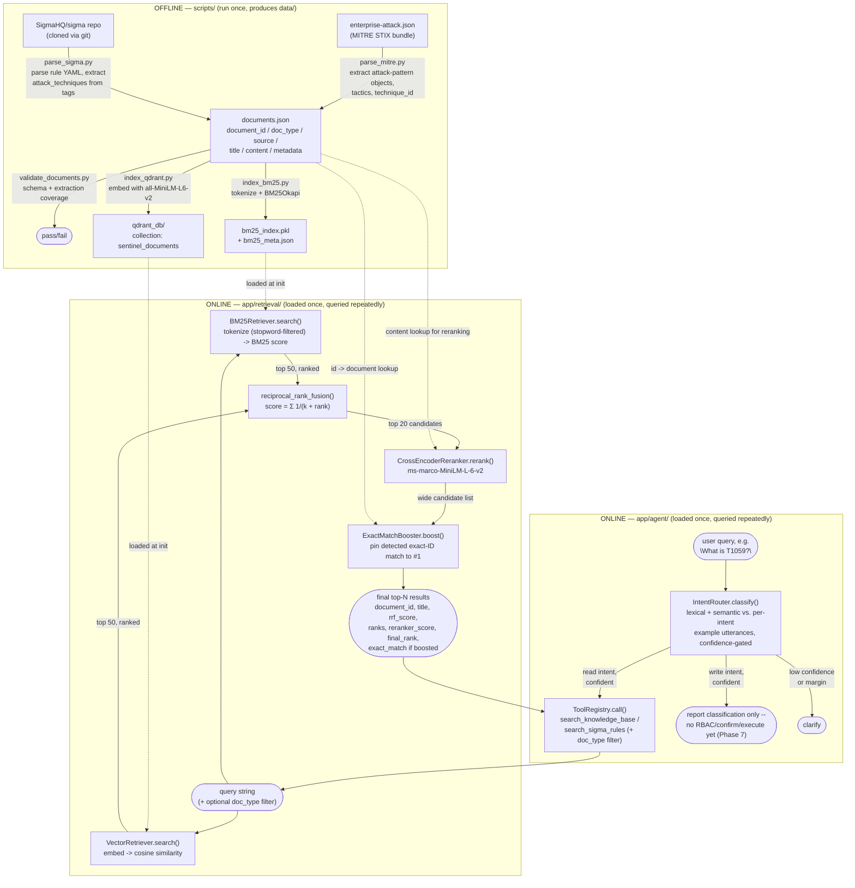

# Architecture

sentinel-ai is a hybrid-search RAG system over two security knowledge sources today: **MITRE ATT&CK** (techniques) and **SigmaHQ** (detection rules), with the document schema designed to grow to runbooks and security alerts. This doc describes what exists today: an offline ingestion/indexing pipeline, an online hybrid retrieval + reranking path, a retrieval eval harness, an intent router + tool layer, and citation-grounded generation with a post-generation groundedness judge. There is no RBAC or API layer yet — see "Not yet built."

## Directory layout

```
sentinel-ai/
├── data/
│   ├── enterprise-attack.json   # raw MITRE ATT&CK STIX bundle (input)
│   ├── sigma/                   # cloned SigmaHQ/sigma repo (input)
│   ├── documents.json           # unified corpus (intermediate)
│   ├── bm25_index.pkl           # BM25 index (build artifact)
│   ├── bm25_meta.json           # BM25 row -> {document_id, title, doc_type, source} (build artifact)
│   └── qdrant_db/               # embedded Qdrant collection (build artifact)
├── scripts/                     # offline, run-once ETL
│   ├── parse_mitre.py
│   ├── parse_sigma.py
│   ├── index_bm25.py
│   ├── index_qdrant.py
│   ├── validate_documents.py    # schema + extraction-coverage checks
│   └── evaluate_retrieval.py    # BM25 vs vector vs RRF vs RRF+rerank vs RRF+rerank+boost
└── app/                         # online, long-lived query path
    ├── retrieval/
    │   ├── documents.py         # load_documents()/load_content_by_id() -- single source of truth
    │   ├── bm25_retriever.py
    │   ├── vector_retriever.py
    │   ├── fusion.py
    │   ├── reranker.py
    │   ├── exact_match.py       # ExactMatchBooster: pin known-item ID matches to rank 1
    │   └── hybrid.py
    ├── agent/
    │   ├── router.py            # IntentRouter: classify(query) -> intent/category/confidence
    │   ├── tools.py              # Tool schemas (pydantic) + ToolRegistry + handlers
    │   └── orchestrator.py       # glue: router -> tool call (read) or report-only (write)
    └── generation/
        ├── prompts.py            # citation-grounded generation system prompt
        ├── generator.py          # LLM call -> structured claims + citations
        ├── groundedness.py       # NLI judge: is each claim entailed by its cited doc?
        └── pipeline.py           # generate -> verify -> regen-or-reject
```

The split is deliberate: `scripts/` produces artifacts in `data/` and then exits; `app/` loads those artifacts once and answers many queries against them. See [DECISIONS.md](DECISIONS.md).

## Document schema

Every document in `documents.json`, regardless of source, shares the same six top-level fields:

```json
{
  "document_id": "mitre_attack:T1059",
  "doc_type": "attack_technique",
  "source": { "name": "MITRE ATT&CK", "url": "https://attack.mitre.org/techniques/T1059" },
  "title": "Command and Scripting Interpreter",
  "content": "Adversaries may abuse command and script interpreters...",
  "metadata": {
    "technique_id": "T1059",
    "is_subtechnique": false,
    "parent_technique_id": null,
    "tactics": ["execution"],
    "platforms": ["Windows", "Linux", "macOS"],
    "stix_id": "attack-pattern--..."
  }
}
```

```json
{
  "document_id": "sigma:0022869c-49f7-4ff2-ba03-85ac42ddac58",
  "doc_type": "detection_rule",
  "source": {
    "name": "SigmaHQ Sigma",
    "repo": "https://github.com/SigmaHQ/sigma",
    "path": "rules/windows/process_creation/proc_creation_win_discovery_via_reg_queries.yml"
  },
  "title": "System Information Discovery via Registry Queries",
  "content": "System Information Discovery via Registry Queries\nDetects attempts to query...",
  "metadata": {
    "rule_id": "0022869c-49f7-4ff2-ba03-85ac42ddac58",
    "status": "experimental",
    "level": "low",
    "logsource": { "category": "process_creation", "product": "windows" },
    "attack_techniques": ["T1082"],
    "attack_tactics": ["discovery"],
    "tags": ["attack.discovery", "attack.t1082"],
    "references": ["https://cert.gov.ua/article/6277849"],
    "author": "lazarg",
    "raw": "title: System Information Discovery...\n(full original YAML)"
  }
}
```

**Field responsibilities:**
- `document_id` — stable, globally unique, namespaced by source (`mitre_attack:T1059`, `sigma:<uuid>`). Retrieval, indexing, and citations all key off this, never off a source-specific ID directly.
- `doc_type` — what kind of thing this is (`attack_technique`, `detection_rule`, and eventually `runbook`, `security_alert`). Drives filtering, citation formatting, and future intent routing.
- `source` — provenance only: where the doc came from and how to trace it back (a URL, a repo + file path). Never used for identity or type checks — that's what `document_id` and `doc_type` are for.
- `title` / `content` — the searchable text surface. This is what BM25 tokenizes and the embedding model encodes; it stays free of structured data so search quality isn't polluted by field names or IDs bleeding into the text.
- `metadata` — everything structured: source-specific IDs (`technique_id`, `rule_id`), relationships (`parent_technique_id`, `attack_techniques` — the Sigma→ATT&CK join), and anything else worth filtering or joining on later. Sigma's full original YAML lives here too (`metadata.raw`), kept for traceability but demoted to just one field among many — not the thing anything is parsed *from* anymore.

**Extending to new `doc_type`s** (runbooks, synthetic alerts — not built yet, see PROGRESS.md Phase 1): the top-level six fields don't change; only `metadata`'s shape does, per type. A future runbook document would look like:
```json
{
  "document_id": "runbook:credential-dumping-investigation",
  "doc_type": "runbook",
  "source": { "name": "Internal Runbooks", "path": "runbooks/credential-dumping.md" },
  "title": "Credential Dumping Investigation",
  "content": "...",
  "metadata": { "category": "investigation", "related_techniques": ["T1003"] }
}
```
and a synthetic alert:
```json
{
  "document_id": "security_alert:a-1042",
  "doc_type": "security_alert",
  "source": { "name": "Synthetic Alert Corpus" },
  "title": "Suspicious PowerShell Execution on HOST-042",
  "content": "...",
  "metadata": { "severity": "high", "host": "HOST-042", "related_techniques": ["T1059.001"] }
}
```
Neither requires any change to the indexers or retrievers — both only ever touch the six top-level fields plus whatever generic lookups (`metadata.get(...)`) the ingestion for that type chooses to populate.

## Data flow



### Offline: ingestion + indexing (`scripts/`)

1. **`parse_mitre.py`** reads the MITRE ATT&CK Enterprise STIX bundle, keeps only `attack-pattern` objects, and for each extracts the technique ID, tactic(s) from `kill_chain_phases`, sub-technique parent (from the ID itself, e.g. `T1059.001` → parent `T1059`), platforms, and the STIX object ID — writing the canonical schema above into `documents.json`.
2. **`parse_sigma.py`** clones `SigmaHQ/sigma` into `data/sigma/` if not already present, walks every `rules/**/*.yml` (skipping `deprecated/`, `unsupported/`, `ecs/`), and for each valid rule (has a title + detection block) extracts `attack_techniques`/`attack_tactics` from the rule's `tags` (e.g. `attack.t1003.006` → technique `T1003.006`; `attack.credential-access` → tactic `credential-access`), plus `logsource`, `references`, `author`, `status`, `level`. It merges into the existing `documents.json` non-destructively by `doc_type`, not by source string — MITRE (and future non-Sigma) docs are preserved, prior Sigma rows are replaced.
3. **`validate_documents.py`** checks every document has the six required top-level fields, `document_id` is unique, `source` is an object with a name, and that extraction actually worked: ≥95% of `attack_technique` docs must carry a non-empty `tactics` list, ≥50% of `detection_rule` docs must carry a non-empty `attack_techniques` list. Exits non-zero on failure — see [DECISIONS.md](DECISIONS.md) for why those specific floors and the measured coverage (100% / 89%).
4. **`index_bm25.py`** tokenizes `native_id×10 + title + content + metadata.raw` per document (the source-specific ID — `technique_id` or `rule_id` — is repeated to weight exact-ID queries heavily) and builds a `BM25Okapi` index, pickled alongside a lightweight metadata sidecar (`bm25_meta.json`, keyed by `document_id`) so query results don't require re-loading the full corpus. Tokenization strips a small English stopword list (`app/retrieval/bm25_retriever.py:tokenize`, imported here rather than duplicated) — classic Okapi BM25's IDF term goes negative for words in more than half the corpus, so without this a natural-language query like `"What is T1059?"` gets actively penalized by "is"/"what" appearing in most documents. See [DECISIONS.md](DECISIONS.md).
5. **`index_qdrant.py`** embeds `"{native_id}. {title}. {content}"` per document with `sentence-transformers/all-MiniLM-L6-v2` (384-dim, cosine distance), batches upserts of 100 into a local embedded Qdrant collection at `data/qdrant_db/`, payload keyed by `document_id`.
6. **`evaluate_retrieval.py`** runs a fixed 11-query set through BM25-only, vector-only, RRF, RRF+rerank, and RRF+rerank+boost, scoring each against title-substring- or metadata-derived relevance sets. See [DECISIONS.md](DECISIONS.md) for the full results table and methodology.

Current corpus: **3,995 documents** (3,137 Sigma rules + 858 ATT&CK techniques).

### Online: hybrid query + rerank path (`app/retrieval/`)

1. **`BM25Retriever`** (`bm25_retriever.py`) loads the pickled BM25 index + meta once at construction, then on `.search(query, limit)` tokenizes the query the same way as indexing and returns the top-`limit` docs (`document_id`, `title`, `doc_type`, `source`, `score`) by BM25 score (zero-score docs dropped).
2. **`VectorRetriever`** (`vector_retriever.py`) loads the embedding model + opens the Qdrant client once at construction, then on `.search(query, limit)` embeds the query and returns the top-`limit` docs by cosine similarity.
3. **`reciprocal_rank_fusion`** (`fusion.py`) takes any number of named ranked lists (keyed `"bm25"`, `"vector"`) and fuses them by rank position — not raw score — into one ranking, tagging each result with a `ranks` dict showing which retriever(s) found it and at what rank. See [DECISIONS.md](DECISIONS.md) for why RRF and not a weighted blend.
4. **`CrossEncoderReranker`** (`reranker.py`) loads `documents.json` once to build a `document_id -> content` lookup, then re-scores a candidate list against the full query+document text with a cross-encoder, returning results re-sorted with `initial_rank`/`reranker_score`/`final_rank` attached.
5. **`ExactMatchBooster`** (`exact_match.py`) loads `documents.json` once to build `{technique_id: doc}`/`{rule_id: doc}` lookups, detects known-item identifiers in the query via regex (ATT&CK technique IDs, Sigma rule UUIDs), and pins any exact match to the front of a candidate list — a document rank-based fusion found at rank #1 in only one retriever can otherwise be out-ranked by a document found moderately by both (see [DECISIONS.md](DECISIONS.md) for the measured case where this mattered: RRF+rerank alone scored 0.00 on every metric for a natural-language exact-ID question).
6. **`HybridSearcher`** (`hybrid.py`) is the retrieval entry point: constructs both retrievers once, and on `.search(query, limit)` pulls the top 50 candidates from each and fuses them down to the requested `limit` via RRF (`k=60`). It does not call the reranker or booster itself — both are composed on top explicitly (in their own `main()`s, in the eval script, and in the tool layer) so BM25/vector/RRF/RRF+rerank/RRF+rerank+boost all stay independently runnable and comparable, per PLAN §11.

Run any stage directly:
```
python -m app.retrieval.hybrid
python -m app.retrieval.reranker
python -m app.retrieval.exact_match
python scripts/evaluate_retrieval.py
python scripts/validate_documents.py
```

Both retrievers, the reranker, the booster, and the fused searcher are safe to hold as long-lived instances (e.g. one of each per process) — this is intentional so a future API layer doesn't reload models/indices per request.

### Online: intent routing + tool layer (`app/agent/`)

This is the "Read vs Write" branch from PLAN §3's architecture diagram — it decides what a natural-language query is asking for and routes it, without yet being able to actually execute a write.

1. **`IntentRouter`** (`router.py`) classifies a query against a small fixed set of intents (`explain_technique`, `search_detection_rule`, `search_knowledge_base` — read; `block_ip`, `isolate_endpoint` — write), each defined by a handful of example utterances plus optional keyword/regex signals. Scoring combines a semantic signal (max cosine similarity against an intent's example-utterance embeddings, same `all-MiniLM-L6-v2` model retrieval already uses) with a lexical signal (keyword/technique-ID-pattern match), then gates the decision on both an absolute confidence threshold (stricter for write intents) and a minimum margin over the runner-up intent. Below either bar, it returns `clarify` instead of guessing. See [DECISIONS.md](DECISIONS.md) for the full rationale and the specific edge cases this was verified against.
2. **`ToolRegistry`** (`tools.py`) holds 8 tools matching PLAN §13's initial list, each a `Tool` dataclass declaring `name`, `description`, `category`, `side_effecting`, `idempotent`, `required_permission`, `audit_event`, a pydantic `input_model`, and a `handler`. Two are real (`search_knowledge_base`, `search_sigma_rules` — both call the full RRF+rerank+boost pipeline with an optional/fixed `doc_type` filter); three are honest stubs returning "no data source yet" (`lookup_ioc`, `get_alert`, `get_incident` — blocked on Phase 1/8); three are honest stubs returning `{"status": "not_executed", ...}` (`create_incident`, `block_ip`, `isolate_endpoint` — blocked on Phase 7's RBAC/confirm/execute pipeline).
3. **`Orchestrator`** (`orchestrator.py`) is the thin glue: classify, then for a confident read intent call the matching tool (an intent and a tool are not the same thing — `explain_technique` and `search_knowledge_base` both end up calling the `search_knowledge_base` tool, just with a different `doc_type`); for a confident write intent, report the classification and stop, since there's nowhere further to hand it off to yet; for `clarify`, return the router's message as-is.

Run it directly:
```
python -m app.agent.router
python -m app.agent.tools
python -m app.agent.orchestrator
```

**Deliberately not built here:** entity/slot extraction (turning "block that IP" into a validated `ip_address`). The router's job is classifying *what* the user wants; extracting the *arguments* a write action needs is treated as a separate, harder problem left to PLAN's Action Planner (Phase 7) — building it now would be building for a pipeline stage (RBAC/confirm/execute) that doesn't exist to receive its output.

### Online: generation + groundedness (`app/generation/`)

Turns a read tool's ranked results into an actual cited answer (PLAN §14/§15), then verifies it before returning it (PLAN §16) — the last two boxes in PLAN §3's Read pipeline.

1. **`Generator`** (`generator.py`) calls an LLM (see "LLM provider" below) with the query and the full text of the retrieved evidence documents, using structured output (`response_format: json_object` + Pydantic validation) to get back a `GeneratedAnswer`: a list of `Claim`s, each `{text, cited_document_ids}`, plus an `insufficient_evidence` flag — not free-text the caller has to parse. This structure is what makes the next step possible without a fragile sentence-splitting pass.
2. **`GroundednessJudge`** (`groundedness.py`) checks each claim individually against *only the document(s) it cites* using an NLI cross-encoder (`MoritzLaurer/DeBERTa-v3-base-mnli-fever-anli`, loaded once via `sentence-transformers.CrossEncoder` — same pattern as the reranker) — premise = cited document's content, hypothesis = the claim text, checked for entailment probability above a threshold. Catches three distinct failure modes: hallucination (no support anywhere), misattribution (a real, relevant citation that doesn't actually say the specific thing claimed), and a fabricated `document_id` (empty evidence text, always fails). An answer is `grounded` only if **every** claim passes — see [DECISIONS.md](DECISIONS.md) for why this specific NLI checkpoint, not the first one tried.
3. **`GenerationPipeline`** (`pipeline.py`) ties them together with the regen-or-reject path: generate → verify → if ungrounded, retry once naming exactly which claims failed → if still ungrounded, return only the claims that verified, with an explicit "insufficient evidence" note. A `GeneratedAnswer` with zero claims (the model correctly declining) short-circuits as an immediate success — there's nothing to retry.

**LLM provider:** not the Anthropic API — the user supplied their own OpenAI-compatible endpoint and model (`deepseek/deepseek-v4-flash` via a third-party proxy), configured through a local `.env` (`LLM_API_KEY`, `LLM_ENDPOINT`, loaded with `python-dotenv`; `.env` is gitignored). `generator.py` uses the `openai` Python SDK pointed at that `base_url`. See [DECISIONS.md](DECISIONS.md) for a real gotcha found while wiring this up: the endpoint serves a reasoning model whose hidden reasoning tokens are billed against the same `max_tokens` as the visible answer, so a tight token budget silently truncates output.

Run it directly:
```
python -m app.generation.generator
python -m app.generation.groundedness
python -m app.generation.pipeline
```

## Not yet built

These are the natural next layers, not yet implemented:

- **API layer** (`fastapi`/`uvicorn`/`pydantic` are already in `requirements.txt`): a thin HTTP wrapper around `Orchestrator`, likely `app/main.py` + `app/api/chat.py`, holding one instance at process startup.
- **`Orchestrator` doesn't call `GenerationPipeline` yet**: Phase 5's `Orchestrator` still returns raw tool results for read intents; wiring in `app/generation/` so a read query gets a cited answer instead of a ranked list is the natural next step, not yet done.
- **`pysigma`** (already in `requirements.txt`, unused so far): intended for translating Sigma detection logic into query-backend-specific queries (e.g. for a "does this rule apply to my SIEM" feature) — not wired into retrieval.
- **Runbooks and synthetic alerts** (PLAN §4.3/§4.4): the schema is designed to accept them (see "Extending to new doc_types" above) but neither corpus exists yet; `lookup_ioc`/`get_alert`/`get_incident` stay stubs until they do.
- **RBAC + propose-confirm-execute** (PLAN §17-19, Phase 7): `block_ip`/`isolate_endpoint`/`create_incident` are classified correctly by the router and declare their eventual `required_permission`, but nothing executes them — no authorization check, no confirmation step, no mock firewall/EDR/incident API to call.
- **Entity/slot extraction**: turning a write query into validated tool input (e.g. "block that IP" → an actual IP address). Intentionally deferred — see the agent layer section above.
