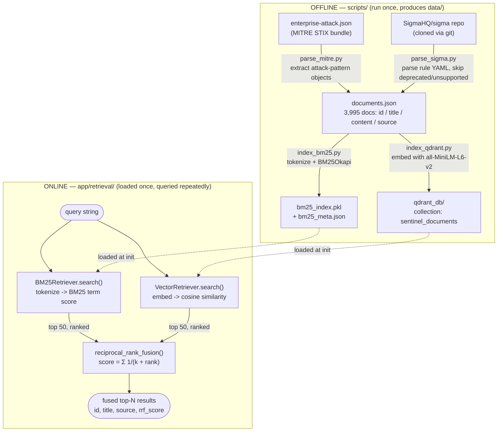

# Architecture

sentinel-ai is a hybrid-search RAG system over two security knowledge sources: **MITRE ATT&CK** (techniques) and **SigmaHQ** (detection rules). This doc describes what exists today: an offline ingestion/indexing pipeline and an online hybrid retrieval path. There is no API or LLM layer yet — see "Not yet built."

## Directory layout

```
sentinel-ai/
├── data/
│   ├── enterprise-attack.json   # raw MITRE ATT&CK STIX bundle (input)
│   ├── sigma/                   # cloned SigmaHQ/sigma repo (input)
│   ├── documents.json           # unified corpus (intermediate)
│   ├── bm25_index.pkl           # BM25 index (build artifact)
│   ├── bm25_meta.json           # BM25 row -> {id, title, source} (build artifact)
│   └── qdrant_db/               # embedded Qdrant collection (build artifact)
├── scripts/                     # offline, run-once ETL
│   ├── parse_mitre.py
│   ├── parse_sigma.py
│   ├── index_bm25.py
│   └── index_qdrant.py
└── app/                         # online, long-lived query path
    └── retrieval/
        ├── bm25_retriever.py
        ├── vector_retriever.py
        ├── fusion.py
        └── hybrid.py
```

The split is deliberate: `scripts/` produces artifacts in `data/` and then exits; `app/` loads those artifacts once and answers many queries against them. See [DECISIONS.md](DECISIONS.md).

## Data flow



### Offline: ingestion + indexing (`scripts/`)

1. **`parse_mitre.py`** reads the MITRE ATT&CK Enterprise STIX bundle, keeps only `attack-pattern` objects, extracts the human-readable technique ID (e.g. `T1059`) from `external_references`, and writes `{id, title, content, source: "MITRE ATT&CK"}` rows into `documents.json`.
2. **`parse_sigma.py`** clones `SigmaHQ/sigma` into `data/sigma/` if not already present, walks every `rules/**/*.yml` (skipping `deprecated/`, `unsupported/`, `ecs/`), and for each valid rule (has a title + detection block) emits `{id: rule uuid, title, content: title+description+tags, raw: full YAML, source: "SigmaHQ Sigma"}`. It merges into the existing `documents.json` non-destructively — MITRE rows are preserved, prior Sigma rows are replaced.
3. **`index_bm25.py`** tokenizes `id×10 + title + content + raw` per document (the ID is repeated to weight exact-ID queries heavily) and builds a `BM25Okapi` index, pickled alongside a lightweight metadata sidecar (`bm25_meta.json`) so query results don't require re-loading the full corpus.
4. **`index_qdrant.py`** embeds `"{id}. {title}. {content}"` per document with `sentence-transformers/all-MiniLM-L6-v2` (384-dim, cosine distance), batches upserts of 100 into a local embedded Qdrant collection at `data/qdrant_db/`.

Current corpus: **3,995 documents** (3,137 Sigma rules + 858 ATT&CK techniques).

### Online: hybrid query path (`app/retrieval/`)

1. **`BM25Retriever`** (`bm25_retriever.py`) loads the pickled BM25 index + meta once at construction, then on `.search(query, limit)` tokenizes the query the same way as indexing and returns the top-`limit` docs by BM25 score (zero-score docs dropped).
2. **`VectorRetriever`** (`vector_retriever.py`) loads the embedding model + opens the Qdrant client once at construction, then on `.search(query, limit)` embeds the query and returns the top-`limit` docs by cosine similarity via `client.query_points`.
3. **`reciprocal_rank_fusion`** (`fusion.py`) takes any number of ranked lists and fuses them by rank position — not raw score — into one ranking. See [DECISIONS.md](DECISIONS.md) for why RRF and not a weighted blend.
4. **`HybridSearcher`** (`hybrid.py`) is the entry point: constructs both retrievers once, and on `.search(query, limit)` pulls the top 50 candidates from each and fuses them down to the requested `limit` via RRF (`k=60`).

Run it directly:
```
python -m app.retrieval.hybrid
```

Both retrievers and the fused searcher are safe to hold as a single long-lived instance (e.g. one `HybridSearcher` per process) — this is intentional so a future API layer doesn't reload models/indices per request.

## Not yet built

These are the natural next layers, not yet implemented:

- **API layer** (`fastapi`/`uvicorn`/`pydantic` are already in `requirements.txt`): a thin HTTP wrapper around `HybridSearcher`, likely `app/main.py` + `app/routes/search.py`, holding one `HybridSearcher` instance at process startup.
- **Answer synthesis**: an LLM step that takes the fused top-N docs and generates a cited answer (technique/rule IDs as citations), rather than returning a raw ranked list.
- **`pysigma`** (already in `requirements.txt`, unused so far): intended for translating Sigma detection logic into query-backend-specific queries (e.g. for a "does this rule apply to my SIEM" feature) — not wired into retrieval.
- **Re-ranking**: a cross-encoder pass over RRF's fused candidates for higher precision, once there's an eval set to justify the added latency.
- **Eval set**: a small labeled query→relevant-doc set to replace the current ad-hoc smoke-test queries and let `k`/`candidate_limit` be tuned instead of left at paper defaults.
- **Version control**: this directory is not yet a git repo.
