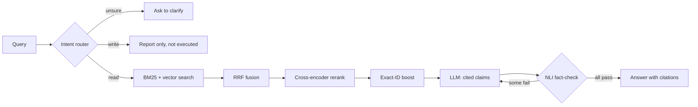

# Sentinel AI

A cited, fact-checked question-answering assistant for SOC analysts, built on MITRE ATT&CK and SigmaHQ detection rules.

Every claim in an answer cites a source document and is checked against that document by a separate model before it reaches the user. Claims that fail are retried once, then dropped.

> **Status: work in progress.** The read pipeline works end to end from a CLI. Write actions such as blocking an IP are classified but never executed. See [Roadmap](#roadmap).

## How it works



| Stage | What it does | Implementation |
|---|---|---|
| **Corpus** | 3,995 documents: 858 ATT&CK techniques and 3,137 Sigma rules | [`scripts/`](scripts/) |
| **Routing** | Combines semantic and keyword signals; asks the user to clarify when unsure, with a higher bar for write intents | [`router.py`](app/agent/router.py) |
| **Retrieval** | BM25 and vector search (top 50 each), merged with Reciprocal Rank Fusion | [`hybrid.py`](app/retrieval/hybrid.py) |
| **Reranking** | Cross-encoder rescores the top 20; exact technique or rule IDs are pinned first; the top 5 go to the LLM | [`reranker.py`](app/retrieval/reranker.py), [`exact_match.py`](app/retrieval/exact_match.py) |
| **Generation** | The LLM returns structured JSON claims, each citing its documents | [`generator.py`](app/generation/generator.py) |
| **Fact-checking** | DeBERTa NLI model tests each claim against only the documents it cites | [`groundedness.py`](app/generation/groundedness.py) |
| **Retry** | One retry naming the failed claims; verified claims are kept across attempts and near-duplicates removed | [`pipeline.py`](app/generation/pipeline.py) |

## Results

**Retrieval** ([`evaluate_retrieval.py`](scripts/evaluate_retrieval.py), 10 queries, K=10):

| Method | Hit@10 | Recall@10 | MRR |
|---|---|---|---|
| BM25 only | 1.000 | 0.645 | 1.000 |
| Vector only | 0.900 | 0.494 | 0.764 |
| RRF | 1.000 | 0.645 | 0.933 |
| RRF + rerank | 1.000 | **0.682** | 1.000 |

Adding a natural-language ID query ("What is T1003.001?") exposed a gap: RRF + rerank dropped the correct document from the top 10. Over the resulting 11 queries, exact-ID boosting improved RRF + rerank from 0.909 / 0.625 / 0.909 to **1.000 / 0.715 / 1.000**.

**Fact-checking** ([`evaluate_llm_judge.py`](scripts/evaluate_llm_judge.py), 18 labeled claims):

| Judge | Accuracy | Time per claim |
|---|---|---|
| DeBERTa NLI (in use) | 18/18 | 11.34 s |
| LLM as judge (rejected) | 13/18 | 1.02 s |

**Limitations**
- The evaluation sets are small. Retrieval relevance is judged by title-matching rules rather than hand labels, so treat these numbers as directional.
- Queries are slow: about 112 s on average across 4 measured queries, on CPU. Most of that time is LLM calls.
- There is no automated test suite yet.

## Quick start

Requires Python 3.10+ and an OpenAI-compatible LLM endpoint.

```bash
git clone https://github.com/VedantK750/sentinel-agentic-AI-SOC-assistant.git
cd sentinel-agentic-AI-SOC-assistant
python3 -m venv .venv && source .venv/bin/activate
pip install -r requirements.txt
```

Create a `.env` file in the project root:

```bash
LLM_API_KEY=your-key
LLM_ENDPOINT=https://your-endpoint/v1
LLM_MODEL=meta-llama/llama-3.1-8b-instruct
```

Build the corpus and indexes. Run these in order, because `parse_mitre.py` overwrites `documents.json` and `parse_sigma.py` merges into it:

```bash
curl -L -o data/enterprise-attack.json \
  https://raw.githubusercontent.com/mitre-attack/attack-stix-data/master/enterprise-attack/enterprise-attack.json

python scripts/parse_mitre.py
python scripts/parse_sigma.py
python scripts/validate_documents.py
python scripts/index_bm25.py
python scripts/index_qdrant.py
```

Ask a question:

```bash
python -m app.cli "What is T1059?"
```

The first run downloads the models.

## Roadmap

- [x] Ingestion, hybrid retrieval, reranking, retrieval evaluation
- [x] Intent router and tool registry
- [x] Cited generation and claim-level fact-checking
- [ ] RBAC and a propose, confirm, execute flow for write actions (mock firewall and EDR)
- [ ] PostgreSQL audit log and FastAPI endpoints
- [ ] Runbook and alert data
- [ ] Tests, CI, Docker, and a minimal React UI

## Documentation

- [ARCHITECTURE.md](ARCHITECTURE.md): system design and data flow
- [DECISIONS.md](DECISIONS.md): technical decisions, benchmarks, and bugs found along the way
- [PROGRESS.md](PROGRESS.md): phase-by-phase status
- [PLAN.md](PLAN.md): full project plan
